# INFORME REDES — RETO 4

## Índice

1. [Resumen del producto](#1-resumen-del-producto)
2. [Preparación de las máquinas](#2-preparación-de-las-máquinas)
   - 2.1. [Configurar el netplan](#21-configurar-el-netplan)
   - 2.2. [Configurar el acceso SSH](#22-configurar-el-acceso-ssh)
   - 2.3. [Router pfSense](#23-router-pfsense)
3. [Servidor DNS (maestro + esclavo)](#3-servidor-dns-maestro--esclavo)
   - 3.1. [Configurar servidor maestro](#31-configurar-servidor-maestro)
   - 3.2. [Configurar servidor esclavo](#32-configurar-servidor-esclavo)
   - 3.3. [Pruebas](#33-pruebas)
4. [Servidor DHCP (primario + secundario)](#4-servidor-dhcp-primario--secundario)
   - 4.1. [Desactivar DHCP en LAN](#41-desactivar-dhcp-en-lan)
   - 4.2. [Configurar servidores DHCP](#42-configurar-servidores-dhcp)
   - 4.3. [Pruebas](#43-pruebas)
5. [Servidor web (apache + monitorix)](#5-servidor-web-apache--monitorix)
   - 5.1. [Configurar servidor web (apache)](#51-configurar-servidor-web-apache)
   - 5.2. [Configurar acceso a monitorix](#52-configurar-acceso-a-monitorix)

---

## 1. RESUMEN DEL PRODUCTO

En este producto se ha pedido configurar una red de servidores que ofrecen diferentes servicios, siendo estos: DNS, DHCP y web.

También se ha dado un router pfSense que permita el acceso a las máquinas y proporcione internet a estas.

Los servicios de estos servidores deben funcionar en toda la red, y deben estar configurados como se especifica en la hoja del producto.

La página web del reto se debe colgar en el servidor con apache para que se pueda acceder a él desde la red del colegio gracias al router pfSense.

---

## 2. PREPARACIÓN DE LAS MÁQUINAS

### 2.1. Configurar el netplan

Lo primero que se debe hacer antes de empezar con el trabajo pedido es configurar la tarjeta de red de cada máquina virtual, de manera que puedan acceder a internet y tengan conectividad entre ellas. Se deberá crear el archivo de red en la carpeta `/etc/netplan` y especificar en él lo que se quiera.

En los servidores 1, 2 y 3, se debe configurar una IP estática, apuntar a los servidores DNS e incluir el dominio.

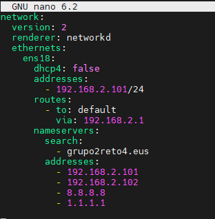

<details><summary>Ver transcripción en texto</summary>

```yaml
network:
  version: 2
  renderer: networkd
  ethernets:
    ens18:
      dhcp4: false
      addresses:
        - 192.168.2.101/24
      routes:
        - to: default
          via: 192.168.2.1
      nameservers:
        search:
          - grupo2reto4.eus
        addresses:
          - 192.168.2.101
          - 192.168.2.102
          - 8.8.8.8
          - 1.1.1.1
```

</details>

En el servidor 4, se pondrá en la tarjeta de red que este pida IP al servidor DHCP. El resto de la configuración la hará el servidor al darle la IP.


<details><summary>Ver transcripción en texto</summary>

```yaml
network:
  version: 2
  renderer: networkd
  ethernets:
    ens18:
      dhcp4: true
```

</details>

### 2.2. Configurar el acceso SSH

Lo siguiente es configurar el acceso por ssh a cada máquina virtual. El router no necesita acceso por consola ya que tiene una interfaz gráfica a la que se puede acceder desde la red del aula. Es importante mencionar que para que funcione, antes se deben abrir puertos en el router para redireccionar el acceso a cada máquina, de lo contrario, no se podrá acceder a la red virtual.

Lo primero que se debe hacer es crear un par de claves de acceso para cada integrante del grupo. En la captura se muestra el comando utilizado y una parte de su salida (una de las claves).

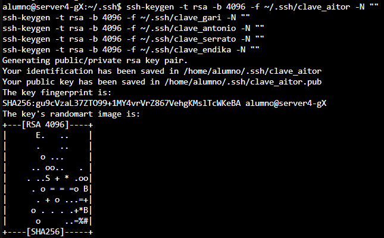

<details><summary>Ver transcripción en texto</summary>

```bash
alumno@server4-gX:~/.ssh$ ssh-keygen -t rsa -b 4096 -f ~/.ssh/clave_aitor -N ""
ssh-keygen -t rsa -b 4096 -f ~/.ssh/clave_gari -N ""
ssh-keygen -t rsa -b 4096 -f ~/.ssh/clave_antonio -N ""
ssh-keygen -t rsa -b 4096 -f ~/.ssh/clave_serrato -N ""
ssh-keygen -t rsa -b 4096 -f ~/.ssh/clave_endika -N ""
Generating public/private rsa key pair.
Your identification has been saved in /home/alumno/.ssh/clave_aitor
Your public key has been saved in /home/alumno/.ssh/clave_aitor.pub
The key fingerprint is:
SHA256:gu9cVzaL37ZTO99+1MY4vrVrZ867VehgKMslTcWKeBA alumno@server4-gX
The key's randomart image is:
+---[RSA 4096]----+
|      E.   ..    |
|       .    ..   |
|        o ...    |
|     .. oo..   . |
|    . ..S + * .oo|
|     . o = = =o B|
|      . + o ...=+|
|     o . . . .+*B|
|      o     ..=%#|
+----[SHA256]-----+
```

</details>

Una vez creadas las claves, lo siguiente será introducir las claves públicas de cada integrante del equipo en el archivo **authorized_keys**, de manera que al intentar acceder a las máquinas utilizando las claves privadas, estas funcionen y permitan el acceso.

En la captura se muestra el comando utilizado para introducir las claves en el archivo mencionado.

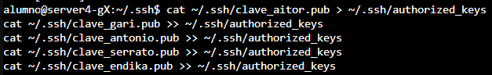

<details><summary>Ver transcripción en texto</summary>

```bash
alumno@server4-gX:~/.ssh$ cat ~/.ssh/clave_aitor.pub > ~/.ssh/authorized_keys
cat ~/.ssh/clave_gari.pub >> ~/.ssh/authorized_keys
cat ~/.ssh/clave_antonio.pub >> ~/.ssh/authorized_keys
cat ~/.ssh/clave_serrato.pub >> ~/.ssh/authorized_keys
cat ~/.ssh/clave_endika.pub >> ~/.ssh/authorized_keys
```

</details>

Para pasar las claves privadas de cada miembro a los equipos windows, se usará el comando **cat** en cada archivo de clave privada y se copiará su contenido en un archivo de texto (u otro tipo) en el equipo windows del aula.

Por último, se cambiarán los permisos de algunos archivos por motivos de seguridad para que nadie pueda mirar las claves creadas.

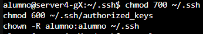

<details><summary>Ver transcripción en texto</summary>

```bash
alumno@server4-gX:~/.ssh$ chmod 700 ~/.ssh
chmod 600 ~/.ssh/authorized_keys
chown -R alumno:alumno ~/.ssh
```

</details>

Este proceso se repite en las 4 máquinas, para crear un par de claves en cada una.

Solo queda probar el acceso por ssh. En este caso, se utiliza MobaXterm para acceder a cada máquina. Se selecciona la IP del router, su puerto que redirija a la máquina a la que se desee acceder y se selecciona la clave privada. Una vez hecho todo eso, se podrá entrar sin ningún problema.

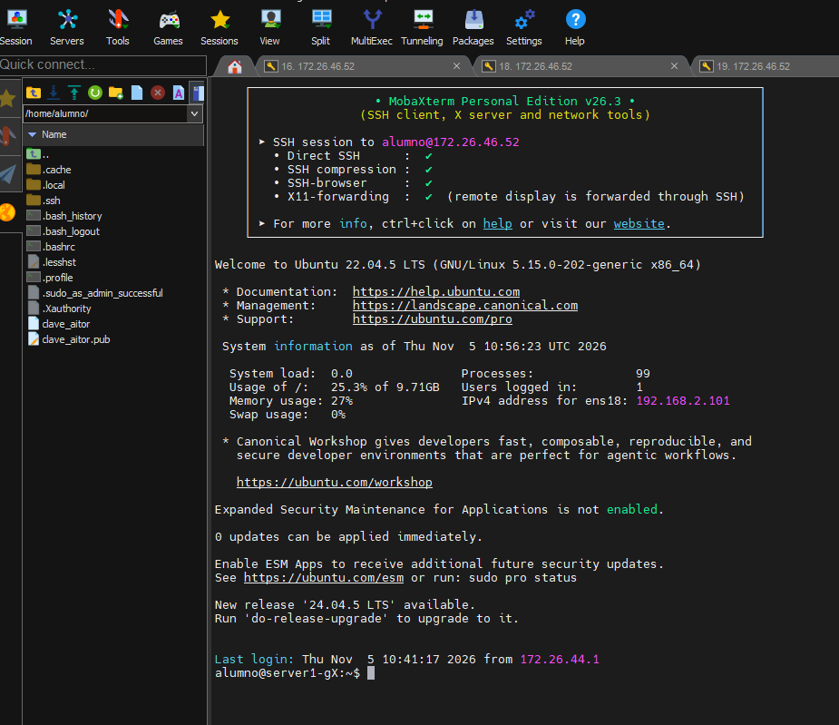

### 2.3. Router pfSense

En el router pfSense, se deben crear varias reglas en el firewall para hacer *port forwarding* y redirigir cierto tráfico del router a las máquinas virtuales, además de bloquear otras acciones.

Lo primero será quitar todas las reglas en las que ponga "any" para hacer una política restrictiva y denegar todo el tráfico. Una vez terminado, la primera regla será permitir el acceso a internet para las máquinas, para que estas puedan descargar los servicios que necesiten.

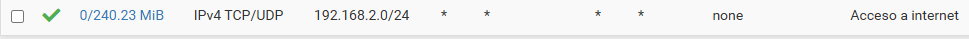

<details><summary>Ver transcripción en texto</summary>

| Estados | Protocolo | Origen | Puerto origen | Destino | Puerto destino | Gateway | Cola | Descripción |
|---|---|---|---|---|---|---|---|---|
| 0/240.23 MiB | IPv4 TCP/UDP | 192.168.2.0/24 | * | * | * | * | none | Acceso a internet |

</details>

Esta regla permite todo el tráfico TCP y UDP que pase por el router hacia la red creada, con origen en la red de las máquinas virtuales.

Lo siguiente es abrir puertos en el router y redirigirlos a diferentes servicios de la red virtual, como el acceso por ssh o acceder a la web. Estos deben hacerse en la sección NAT/port forwarding de las reglas del firewall y deben estar en la interfaz WAN del router.

A continuación se muestra una imagen con las reglas creadas en el firewall, con los puertos abiertos en el router, a qué dirección IP y puerto apuntan y una descripción breve de qué hace cada regla.

**Reglas NAT / Port forwarding (interfaz WAN):**

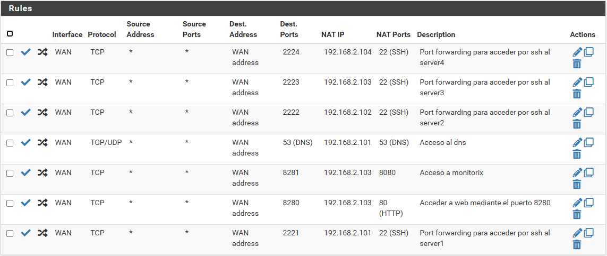

<details><summary>Ver transcripción en texto</summary>

| Interfaz | Protocolo | Origen | Puertos origen | Dirección destino | Puertos destino | NAT IP | NAT Ports | Descripción |
|---|---|---|---|---|---|---|---|---|
| WAN | TCP | * | * | WAN address | 2224 | 192.168.2.104 | 22 (SSH) | Port forwarding para acceder por ssh al server4 |
| WAN | TCP | * | * | WAN address | 2223 | 192.168.2.103 | 22 (SSH) | Port forwarding para acceder por ssh al server3 |
| WAN | TCP | * | * | WAN address | 2222 | 192.168.2.102 | 22 (SSH) | Port forwarding para acceder por ssh al server2 |
| WAN | TCP/UDP | * | * | WAN address | 53 (DNS) | 192.168.2.101 | 53 (DNS) | Acceso al dns |
| WAN | TCP | * | * | WAN address | 8281 | 192.168.2.103 | 8080 | Acceso a monitorix |
| WAN | TCP | * | * | WAN address | 8280 | 192.168.2.103 | 80 (HTTP) | Acceder a la web mediante el puerto 8280 |
| WAN | TCP | * | * | WAN address | 2221 | 192.168.2.101 | 22 (SSH) | Port forwarding para acceder por ssh al server1 |

</details>

Aquí se muestran todas las reglas en el firewall del router. La primera imagen mostrará todas las reglas de la interfaz WAN y la segunda las reglas de la interfaz LAN.

**Reglas de firewall — interfaz WAN:**

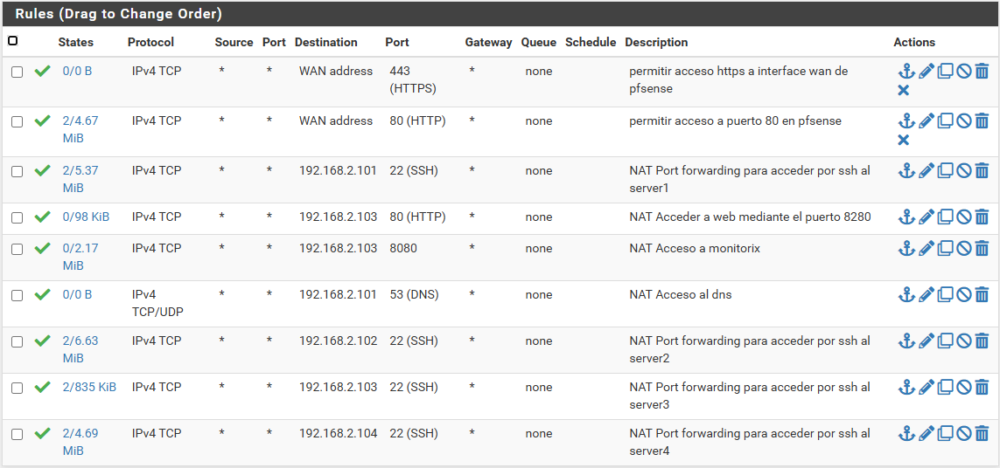

<details><summary>Ver transcripción en texto</summary>

| Estados | Protocolo | Origen | Puerto | Destino | Puerto | Gateway | Cola | Descripción |
|---|---|---|---|---|---|---|---|---|
| 0/0 B | IPv4 TCP | * | * | WAN address | 443 (HTTPS) | * | none | permitir acceso https a interface wan de pfsense |
| 2/4.67 MiB | IPv4 TCP | * | * | WAN address | 80 (HTTP) | * | none | permitir acceso a puerto 80 en pfsense |
| 2/5.37 MiB | IPv4 TCP | * | * | 192.168.2.101 | 22 (SSH) | * | none | NAT Port forwarding para acceder por ssh al server1 |
| 0/98 KiB | IPv4 TCP | * | * | 192.168.2.103 | 80 (HTTP) | * | none | NAT Acceder a web mediante el puerto 8280 |
| 0/2.17 MiB | IPv4 TCP | * | * | 192.168.2.103 | 8080 | * | none | NAT Acceso a monitorix |
| 0/0 B | IPv4 TCP/UDP | * | * | 192.168.2.101 | 53 (DNS) | * | none | NAT Acceso al dns |
| 2/6.63 MiB | IPv4 TCP | * | * | 192.168.2.102 | 22 (SSH) | * | none | NAT Port forwarding para acceder por ssh al server2 |
| 2/835 KiB | IPv4 TCP | * | * | 192.168.2.103 | 22 (SSH) | * | none | NAT Port forwarding para acceder por ssh al server3 |
| 2/4.69 MiB | IPv4 TCP | * | * | 192.168.2.104 | 22 (SSH) | * | none | NAT Port forwarding para acceder por ssh al server4 |

</details>

**Reglas de firewall — interfaz LAN:**

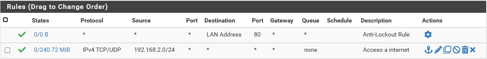

<details><summary>Ver transcripción en texto</summary>

| Estados | Protocolo | Origen | Puerto | Destino | Puerto | Gateway | Cola | Descripción |
|---|---|---|---|---|---|---|---|---|
| 0/0 B | * | * | * | LAN Address | 80 | * | * | Anti-Lockout Rule |
| 0/240.72 MiB | IPv4 TCP/UDP | 192.168.2.0/24 | * | * | * | * | none | Acceso a internet |

</details>

---

## 3. SERVIDOR DNS (maestro + esclavo)

El servidor DNS se encargará de traducir algunos nombres a sus respectivas IPs o al revés, mostrando el nombre de la IP consultada. Para ello, se deberán configurar dos servidores, uno maestro, con todo el contenido de las zonas y otro esclavo, que sólo apuntará al maestro y recibirá la misma configuración que tenga este. Se utilizará el servicio **bind9** para este apartado, y si los pasos anteriores han sido realizados con éxito, se podrá continuar.

Antes de empezar con la instalación y configuración de bind9, es importante que los archivos netplan de cada máquina apunten al dominio DNS **grupo2reto4.eus** y apunten a los 2 servidores DNS que se van a crear, en este caso, estarán en las IPs .101 y .102, como se muestra en la imagen. Se añaden otros servidores externos para realizar el resto de consultas.

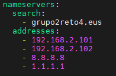

<details><summary>Ver transcripción en texto</summary>

```yaml
nameservers:
  search:
    - grupo2reto4.eus
  addresses:
    - 192.168.2.101
    - 192.168.2.102
    - 8.8.8.8
    - 1.1.1.1
```

</details>

### 3.1. Configurar servidor maestro

Lo primero es instalar bind9 en los 2 servidores que van a dar el servicio. Una vez hecho eso, se configurará el archivo **named.conf.local** dentro de la carpeta bind. En este archivo se declararán la zona directa y la inversa, además de especificar que este servidor será "el maestro" y que debe transferir su información y notificar al servidor .102, que será "el esclavo".

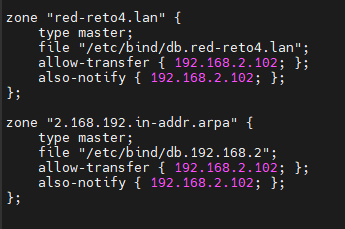

<details><summary>Ver transcripción en texto</summary>

```
zone "red-reto4.lan" {
    type master;
    file "/etc/bind/db.red-reto4.lan";
    allow-transfer { 192.168.2.102; };
    also-notify { 192.168.2.102; };
};

zone "2.168.192.in-addr.arpa" {
    type master;
    file "/etc/bind/db.192.168.2";
    allow-transfer { 192.168.2.102; };
    also-notify { 192.168.2.102; };
};
```

</details>

Lo siguiente será crear los archivos de zonas. En la zona directa, se deben incluir las consultas que se quieran realizar, las cuales traducen el nombre de lo introducido a su respectiva IP. Los registros pueden ser NS (los servidores dns), A (los equipos en la red) y CNAME (otros nombres que apuntan a registros ya especificados). Aquí se muestra una captura con el contenido de la zona directa.

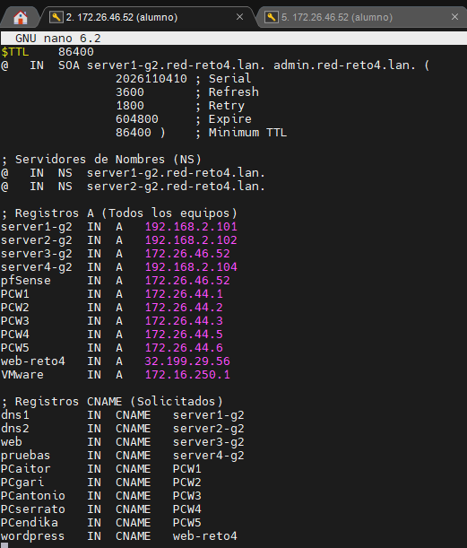

<details><summary>Ver transcripción en texto</summary>

```
$TTL    86400
@   IN  SOA server1-g2.red-reto4.lan. admin.red-reto4.lan. (
            2026110410 ; Serial
            3600       ; Refresh
            1800       ; Retry
            604800     ; Expire
            86400 )    ; Minimum TTL

; Servidores de Nombres (NS)
@   IN  NS  server1-g2.red-reto4.lan.
@   IN  NS  server2-g2.red-reto4.lan.

; Registros A (Todos los equipos)
server1-g2  IN  A   192.168.2.101
server2-g2  IN  A   192.168.2.102
server3-g2  IN  A   172.26.46.52
server4-g2  IN  A   192.168.2.104
pfSense     IN  A   172.26.46.52
PCW1        IN  A   172.26.44.1
PCW2        IN  A   172.26.44.2
PCW3        IN  A   172.26.44.3
PCW4        IN  A   172.26.44.5
PCW5        IN  A   172.26.44.6
web-reto4   IN  A   32.199.29.56
VMware      IN  A   172.16.250.1

; Registros CNAME (Solicitados)
dns1        IN  CNAME   server1-g2
dns2        IN  CNAME   server2-g2
web         IN  CNAME   server3-g2
pruebas     IN  CNAME   server4-g2
PCaitor     IN  CNAME   PCW1
PCgari      IN  CNAME   PCW2
PCantonio   IN  CNAME   PCW3
PCserrato   IN  CNAME   PCW4
PCendika    IN  CNAME   PCW5
wordpress   IN  CNAME   web-reto4
```

</details>

Lo siguiente es configurar la zona inversa del servidor DNS. En esta, se crearán consultas que traducen las IPs introducidas por sus respectivos nombres. En este caso, no es necesario hacer diferentes tipos de consultas, sólo se crearán de tipo NS para conocer los servidores DNS y consultas de tipo PTR, que apuntan nombres de la zona directa a las IPs que se especifiquen en el archivo. A continuación se muestra una captura con el contenido de la zona inversa.

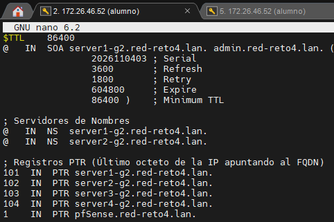

<details><summary>Ver transcripción en texto</summary>

```
$TTL    86400
@   IN  SOA server1-g2.red-reto4.lan. admin.red-reto4.lan. (
            2026110403 ; Serial
            3600       ; Refresh
            1800       ; Retry
            604800     ; Expire
            86400 )    ; Minimum TTL

; Servidores de Nombres
@   IN  NS  server1-g2.red-reto4.lan.
@   IN  NS  server2-g2.red-reto4.lan.

; Registros PTR (Último octeto de la IP apuntando al FQDN)
101 IN  PTR server1-g2.red-reto4.lan.
102 IN  PTR server2-g2.red-reto4.lan.
103 IN  PTR server3-g2.red-reto4.lan.
104 IN  PTR server4-g2.red-reto4.lan.
1   IN  PTR pfSense.red-reto4.lan.
```

</details>

Para terminar, se debe comprobar la sintaxis de los 3 archivos configurados anteriormente en busca de posibles errores. En la captura se muestran los comandos utilizados para ello, y como no devuelven ningún error, significa que están bien.

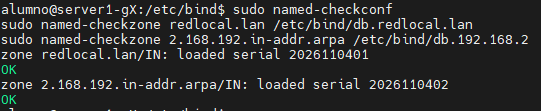

<details><summary>Ver transcripción en texto</summary>

```bash
alumno@server1-gX:/etc/bind$ sudo named-checkconf
sudo named-checkzone redlocal.lan /etc/bind/db.redlocal.lan
sudo named-checkzone 2.168.192.in-addr.arpa /etc/bind/db.192.168.2
zone redlocal.lan/IN: loaded serial 2026110401
OK
zone 2.168.192.in-addr.arpa/IN: loaded serial 2026110402
OK
```

</details>

### 3.2. Configurar servidor esclavo

La configuración del servidor esclavo es mucho más simple que la del servidor maestro. En este caso, solamente se debe configurar el archivo de declaración de zonas y hacer que este apunte al servidor principal y especificar que este es el esclavo. Al hacer eso, este cargará su configuración y dará el mismo servicio con las mismas consultas.

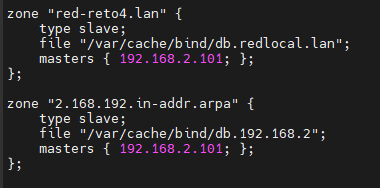

<details><summary>Ver transcripción en texto</summary>

```
zone "red-reto4.lan" {
    type slave;
    file "/var/cache/bind/db.redlocal.lan";
    masters { 192.168.2.101; };
};

zone "2.168.192.in-addr.arpa" {
    type slave;
    file "/var/cache/bind/db.192.168.2";
    masters { 192.168.2.101; };
};
```

</details>

Al terminar, se reinicia el servicio en ambos servidores y se comprueba que se haya transferido el contenido del servidor maestro al esclavo.

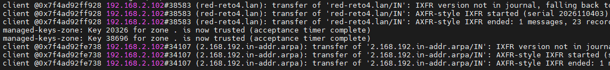

<details><summary>Ver transcripción en texto</summary>

```
client @0x7f4ad92ff928 192.168.2.102#38583 (red-reto4.lan): transfer of 'red-reto4.lan/IN': IXFR version not in journal, falling back to AXFR
client @0x7f4ad92ff928 192.168.2.102#38583 (red-reto4.lan): transfer of 'red-reto4.lan/IN': AXFR-style IXFR started (serial 2026110403)
client @0x7f4ad92ff928 192.168.2.102#38583 (red-reto4.lan): transfer of 'red-reto4.lan/IN': AXFR-style IXFR ended: 1 messages, 23 records
managed-keys-zone: Key 20326 for zone . is now trusted (acceptance timer complete)
managed-keys-zone: Key 38696 for zone . is now trusted (acceptance timer complete)
client @0x7f4ad92fe738 192.168.2.102#34107 (2.168.192.in-addr.arpa): transfer of '2.168.192.in-addr.arpa/IN': IXFR version not in journal...
client @0x7f4ad92fe738 192.168.2.102#34107 (2.168.192.in-addr.arpa): transfer of '2.168.192.in-addr.arpa/IN': AXFR-style IXFR started (...
client @0x7f4ad92fe738 192.168.2.102#34107 (2.168.192.in-addr.arpa): transfer of '2.168.192.in-addr.arpa/IN': AXFR-style IXFR ended: 1 ...
```

</details>

*(Las líneas del log aparecen cortadas en la captura original.)*

### 3.3. Pruebas

Para comprobar que los servidores funcionan correctamente, se pueden realizar algunas pruebas desde el servidor 4. En la siguiente captura, se muestran consultas a la zona directa e inversa de ambos servidores, además de un ping por nombre.

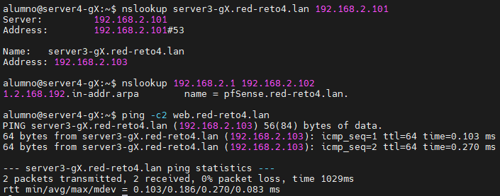

<details><summary>Ver transcripción en texto</summary>

```bash
alumno@server4-gX:~$ nslookup server3-gX.red-reto4.lan 192.168.2.101
Server:         192.168.2.101
Address:        192.168.2.101#53

Name:   server3-gX.red-reto4.lan
Address: 192.168.2.103

alumno@server4-gX:~$ nslookup 192.168.2.1 192.168.2.102
1.2.168.192.in-addr.arpa        name = pfSense.red-reto4.lan.

alumno@server4-gX:~$ ping -c2 web.red-reto4.lan
PING server3-gX.red-reto4.lan (192.168.2.103) 56(84) bytes of data.
64 bytes from server3-gX.red-reto4.lan (192.168.2.103): icmp_seq=1 ttl=64 time=0.103 ms
64 bytes from server3-gX.red-reto4.lan (192.168.2.103): icmp_seq=2 ttl=64 time=0.270 ms

--- server3-gX.red-reto4.lan ping statistics ---
2 packets transmitted, 2 received, 0% packet loss, time 1029ms
rtt min/avg/max/mdev = 0.103/0.186/0.270/0.083 ms
```

</details>

Otra de las pruebas solicitadas es recargar el número serial en el servidor maestro y ver cómo se actualiza en el esclavo. Para ello, lo primero es editar los archivos de las dos zonas y cambiar el número serial. En este caso, se suma solo 1 número.

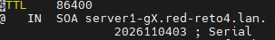

<details><summary>Ver transcripción en texto</summary>

```
$TTL    86400
@   IN  SOA server1-gX.red-reto4.lan.
            2026110403 ; Serial
```

</details>

Después, se reinicia el servicio bind en el servidor maestro y se consultan los logs del servicio bind en el servidor esclavo. Ahí se podrá ver cómo al cargar la información, aparecerá el nuevo número serial, mostrando así cómo ha cogido los nuevos archivos de zonas.

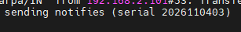

<details><summary>Ver transcripción en texto</summary>

```
sending notifies (serial 2026110403)
```

</details>

Para acceder a las consultas sin necesidad de escribir el sufijo **red-reto4.lan**, se debe acceder a la configuración del DNS de cada equipo y definir el sufijo para que se introduzca solo.

En el caso de Linux, en el archivo netplan se escribe el sufijo en el apartado **search**.

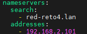

<details><summary>Ver transcripción en texto</summary>

```yaml
nameservers:
  search:
    - red-reto4.lan
  addresses:
    - 192.168.2.101
```

</details>

En el caso de Windows, se accede a la configuración de red del equipo, se entra en las opciones avanzadas y en el apartado del DNS se escribe el sufijo deseado.

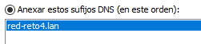

Así, al acceder solamente por nombre a la web o a cualquier otro sitio, entrará sin problema. En la captura se muestra el acceso a la web de prueba en apache a modo de ejemplo.

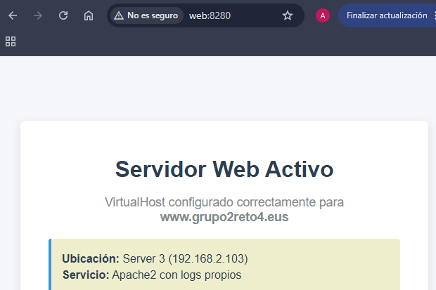

---

## 4. SERVIDOR DHCP (primario + secundario)

El servidor DHCP se encargará de configurar automáticamente las tarjetas de red de aquellos equipos que soliciten una IP por DHCP. Este no solo les dará una dirección IP válida dentro de la red virtual, sino que también les especificará su router, la máscara de red y los servidores DNS. Para que un equipo pueda ser configurado de esta manera, solamente se debe escribir en el archivo netplan `dhcp: true`.

### 4.1. Desactivar DHCP en LAN

Lo primero es desactivar el servidor DHCP que viene por defecto en el router pfSense. Para hacer esto, lo primero será entrar a él por web a su IP de la interfaz WAN, y una vez ahí, se irá al apartado que se muestra en la imagen: **Services / DHCP Server / LAN**.


Al entrar, se verá una casilla marcada en el servicio DHCP. Solamente hay que desactivarla y aplicar los cambios; una vez hecho, el router ya no dará IP por DHCP.

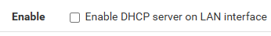

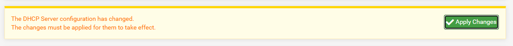

### 4.2. Configurar servidores DHCP

Lo primero es instalar **isc-dhcp-server** en los mismos servidores que el DNS. Una vez hecho, en ambos servidores se configurará el archivo **dhcpd.conf** en la carpeta del servicio DHCP y se introducirá el contenido de la captura.

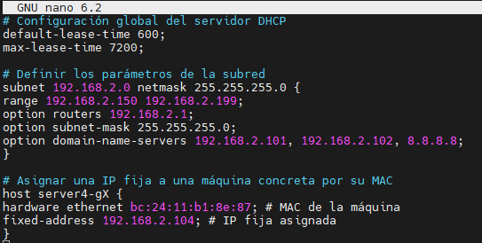

<details><summary>Ver transcripción en texto</summary>

```
# Configuración global del servidor DHCP
default-lease-time 600;
max-lease-time 7200;

# Definir los parámetros de la subred
subnet 192.168.2.0 netmask 255.255.255.0 {
range 192.168.2.150 192.168.2.199;
option routers 192.168.2.1;
option subnet-mask 255.255.255.0;
option domain-name-servers 192.168.2.101, 192.168.2.102, 8.8.8.8;
}

# Asignar una IP fija a una máquina concreta por su MAC
host server4-gX {
hardware ethernet bc:24:11:b1:8e:87; # MAC de la máquina
fixed-address 192.168.2.104; # IP fija asignada
}
```

</details>

En él, se especifica el tiempo que durará la IP dada mediante DHCP, se especificarán otros parámetros como el router o los servidores DNS, y por último se asignará una IP fija al servidor 4. Esto se hace apuntando a la dirección MAC de ese servidor. Al configurar el archivo, se reinicia el servicio en los dos servidores.

### 4.3. Pruebas

Para comprobar que el servidor funciona, lo primero es configurar la tarjeta de red del servidor 4 para que este pida IP mediante DHCP, tal como se muestra en la imagen.

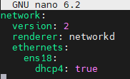

<details><summary>Ver transcripción en texto</summary>

```yaml
network:
  version: 2
  renderer: networkd
  ethernets:
    ens18:
      dhcp4: true
```

</details>

Una vez el servidor pierda la IP que tenía, se pide una al servidor para que este se la dé. Al volver a mirar la dirección IP del servidor, este tendrá la IP fija que se puso en la configuración de los servidores DHCP.

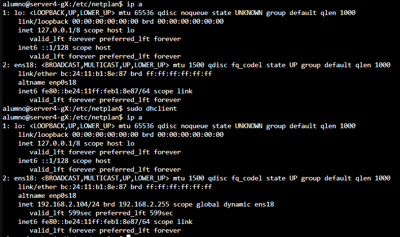

<details><summary>Ver transcripción en texto</summary>

```bash
alumno@server4-gX:/etc/netplan$ ip a
1: lo: <LOOPBACK,UP,LOWER_UP> mtu 65536 qdisc noqueue state UNKNOWN group default qlen 1000
    link/loopback 00:00:00:00:00:00 brd 00:00:00:00:00:00
    inet 127.0.0.1/8 scope host lo
       valid_lft forever preferred_lft forever
    inet6 ::1/128 scope host
       valid_lft forever preferred_lft forever
2: ens18: <BROADCAST,MULTICAST,UP,LOWER_UP> mtu 1500 qdisc fq_codel state UP group default qlen 1000
    link/ether bc:24:11:b1:8e:87 brd ff:ff:ff:ff:ff:ff
    altname enp0s18
    inet6 fe80::be24:11ff:feb1:8e87/64 scope link
       valid_lft forever preferred_lft forever
alumno@server4-gX:/etc/netplan$ sudo dhclient
alumno@server4-gX:/etc/netplan$ ip a
1: lo: <LOOPBACK,UP,LOWER_UP> mtu 65536 qdisc noqueue state UNKNOWN group default qlen 1000
    link/loopback 00:00:00:00:00:00 brd 00:00:00:00:00:00
    inet 127.0.0.1/8 scope host lo
       valid_lft forever preferred_lft forever
    inet6 ::1/128 scope host
       valid_lft forever preferred_lft forever
2: ens18: <BROADCAST,MULTICAST,UP,LOWER_UP> mtu 1500 qdisc fq_codel state UP group default qlen 1000
    link/ether bc:24:11:b1:8e:87 brd ff:ff:ff:ff:ff:ff
    altname enp0s18
    inet 192.168.2.104/24 brd 192.168.2.255 scope global dynamic ens18
       valid_lft 599sec preferred_lft 599sec
    inet6 fe80::be24:11ff:feb1:8e87/64 scope link
       valid_lft forever preferred_lft forever
```

</details>

Se pueden realizar otras pruebas como mirar el funcionamiento de los servidores DNS.

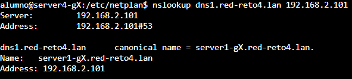

<details><summary>Ver transcripción en texto</summary>

```bash
alumno@server4-gX:/etc/netplan$ nslookup dns1.red-reto4.lan 192.168.2.101
Server:         192.168.2.101
Address:        192.168.2.101#53

dns1.red-reto4.lan      canonical name = server1-gX.red-reto4.lan.
Name:   server1-gX.red-reto4.lan
Address: 192.168.2.101
```

</details>

Estas comprobaciones se han hecho desde la consola de Proxmox, ya que al quitarle la IP al servidor 4, se pierde el acceso por ssh.

---

## 5. SERVIDOR WEB (apache + monitorix)

El servidor apache albergará una página web de prueba creada para este producto, a la cual se podrá acceder desde la red del centro mediante IP. Este mismo servidor también tendrá el servicio Monitorix, el cual sirve para monitorizar distintos aspectos del servidor desde internet.

### 5.1. Configurar servidor web (apache)

Lo primero que se debe hacer es instalar **apache2** en el servidor 3 y crear las carpetas necesarias para este apartado. En este caso, se necesitan carpetas para albergar la página web y sus logs, como se muestra en la captura.

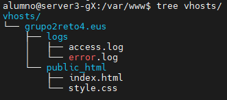

<details><summary>Ver transcripción en texto</summary>

```bash
alumno@server3-gX:/var/www$ tree vhosts/
vhosts/
└── grupo2reto4.eus
    ├── logs
    │   ├── access.log
    │   └── error.log
    └── public_html
        ├── index.html
        └── style.css
```

</details>

Lo siguiente es dar permisos a la carpeta con los logs y el contenido de la web para poder editar los archivos. El comando utilizado es el siguiente:

```bash
sudo chown -R www-data:www-data /var/www/vhosts/grupo2reto4.eus
```

Una vez hecho eso, se pueden crear los contenidos de la página. Puede ser un html simple con algunos estilos algo más extenso y es importante que el html apunte al css para coger sus estilos.

Al haber creado el contenido de la web, se puede crear un host virtual en el archivo **sites-available** especificando los archivos de logs y los que contienen la web.

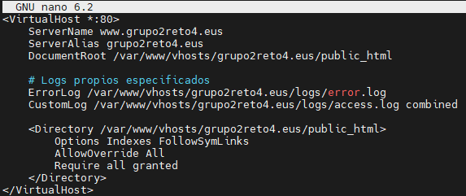

<details><summary>Ver transcripción en texto</summary>

```apache
<VirtualHost *:80>
    ServerName www.grupo2reto4.eus
    ServerAlias grupo2reto4.eus
    DocumentRoot /var/www/vhosts/grupo2reto4.eus/public_html

    # Logs propios especificados
    ErrorLog /var/www/vhosts/grupo2reto4.eus/logs/error.log
    CustomLog /var/www/vhosts/grupo2reto4.eus/logs/access.log combined

    <Directory /var/www/vhosts/grupo2reto4.eus/public_html>
        Options Indexes FollowSymLinks
        AllowOverride All
        Require all granted
    </Directory>
</VirtualHost>
```

</details>

Ahora se desactivará la página web por defecto de apache y se activará la web recién creada con los comandos `a2dissite` y `a2ensite`.

Si todo se ha realizado correctamente, al acceder a la dirección <http://172.26.46.52:8280> se verá la página web. Debe verse igual que en la siguiente captura. También se puede acceder a ella por nombre gracias al DNS.

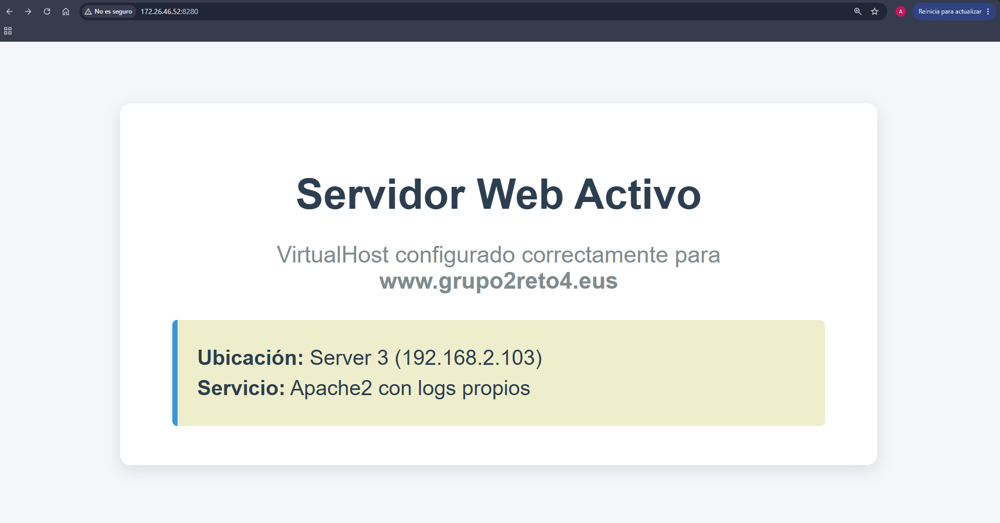

Al visualizar los logs de acceso de la página, se puede ver qué IP ha accedido a la web. El archivo de logs de errores está vacío, ya que no se ha detectado ningún error.

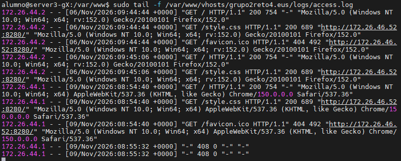

<details><summary>Ver transcripción en texto</summary>

```
alumno@server3-gX:/var/www$ sudo tail -f /var/www/vhosts/grupo2reto4.eus/logs/access.log
172.26.44.2 - - [06/Nov/2026:09:44:44 +0000] "GET / HTTP/1.1" 200 754 "-" "Mozilla/5.0 (Windows NT 10.0; Win64; x64; rv:152.0) Gecko/20100101 Firefox/152.0"
172.26.44.2 - - [06/Nov/2026:09:44:44 +0000] "GET /style.css HTTP/1.1" 200 689 "http://172.26.46.52:8280/" "Mozilla/5.0 (Windows NT 10.0; Win64; x64; rv:152.0) Gecko/20100101 Firefox/152.0"
172.26.44.2 - - [06/Nov/2026:09:44:44 +0000] "GET /favicon.ico HTTP/1.1" 404 492 "http://172.26.46.52:8280/" "Mozilla/5.0 (Windows NT 10.0; Win64; x64; rv:152.0) Gecko/20100101 Firefox/152.0"
172.26.44.2 - - [06/Nov/2026:09:45:06 +0000] "GET / HTTP/1.1" 200 754 "-" "Mozilla/5.0 (Windows NT 10.0; Win64; x64; rv:152.0) Gecko/20100101 Firefox/152.0"
172.26.44.2 - - [06/Nov/2026:09:45:06 +0000] "GET /style.css HTTP/1.1" 200 689 "http://172.26.46.52:8280/" "Mozilla/5.0 (Windows NT 10.0; Win64; x64; rv:152.0) Gecko/20100101 Firefox/152.0"
172.26.44.1 - - [09/Nov/2026:08:54:40 +0000] "GET / HTTP/1.1" 200 754 "-" "Mozilla/5.0 (Windows NT 10.0; Win64; x64) AppleWebKit/537.36 (KHTML, like Gecko) Chrome/150.0.0.0 Safari/537.36"
172.26.44.1 - - [09/Nov/2026:08:54:40 +0000] "GET /style.css HTTP/1.1" 200 689 "http://172.26.46.52:8280/" "Mozilla/5.0 (Windows NT 10.0; Win64; x64) AppleWebKit/537.36 (KHTML, like Gecko) Chrome/150.0.0.0 Safari/537.36"
172.26.44.1 - - [09/Nov/2026:08:54:40 +0000] "GET /favicon.ico HTTP/1.1" 404 492 "http://172.26.46.52:8280/" "Mozilla/5.0 (Windows NT 10.0; Win64; x64) AppleWebKit/537.36 (KHTML, like Gecko) Chrome/150.0.0.0 Safari/537.36"
172.26.44.1 - - [09/Nov/2026:08:55:32 +0000] "-" 408 0 "-" "-"
172.26.44.1 - - [09/Nov/2026:08:55:32 +0000] "-" 408 0 "-" "-"
```

</details>

### 5.2. Configurar acceso a monitorix

Para poder acceder a Monitorix no es necesario realizar ninguna configuración, solamente se debe instalar en el servidor 3 y se accede a la dirección <http://172.26.46.52:8281/monitorix/>. Al entrar, se puede elegir qué se quiere comprobar acerca del servidor. En la captura se muestra un ejemplo del acceso a Monitorix por web. Se puede acceder a él por nombre al igual que la web de apache, con la única diferencia de que se debe cambiar el puerto y apuntar a la carpeta monitorix: <http://web.red-reto4.lan:8281/monitorix>

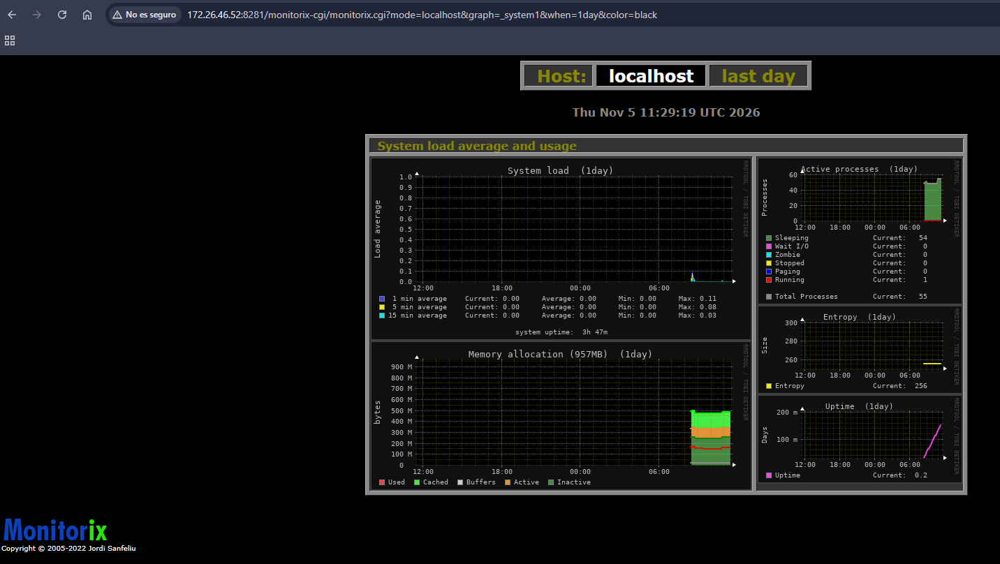
