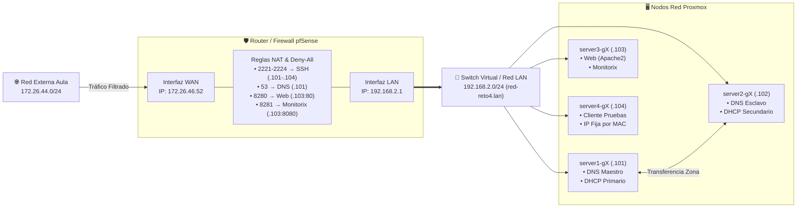

# Mapa Lógico de la Red - Reto 4

Este documento describe la topología lógica, el enrutamiento y los servicios desplegados en la infraestructura virtualizada sobre Proxmox y protegida mediante pfSense.

## Diagrama de Topología (Mermaid - Horizontal)

## Resumen de Flujos de Red y Enrutamiento

1. **Acceso desde el Exterior (`172.26.44.0/24`):**
   * Las peticiones entran a través de la interfaz WAN de **pfSense** (`172.26.46.52`).
   * El firewall aplica una política restrictiva (*Deny-All*) y permite el acceso mediante **NAT Port Forwarding**.
   * El DNS (`server1-gX`) procesa las consultas desde la red externa gracias a la ACL ampliada.

2. **Comunicaciones Internas (`192.168.2.0/24`):**
   * **Resolución de nombres:** `server1-gX` (maestro) sincroniza las zonas directa e inversa con `server2-gX` (esclavo).
   * **Asignación de IP:** DHCP gestionado por los servidores 1 y 2 con reserva estática por MAC para el servidor 4.
   * **Acceso SSH:** Restringido mediante pares de claves RSA de 4096 bits para los 5 usuarios autorizados.