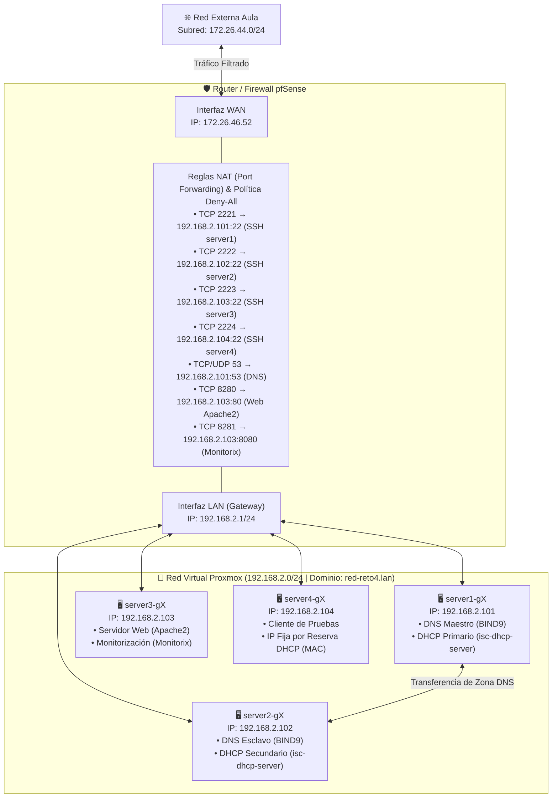

# Mapa Lógico de la Red - Reto 4

Este documento describe la topología lógica, el enrutamiento y los servicios desplegados en la infraestructura virtualizada sobre Proxmox y protegida mediante pfSense.

## Diagrama de Topología (Mermaid)

## Resumen de Flujos de Red y Enrutamiento

1. **Acceso desde el Exterior (`172.26.44.0/24`):**
   - Todas las peticiones entran a través de la interfaz WAN de **pfSense** (`172.26.46.52`).
   - El firewall aplica una política restrictiva (*Deny-All* por defecto) y únicamente permite el paso a los puertos redirigidos explícitamente mediante reglas **NAT Port Forwarding**.
   - El servidor DNS (`server1-gX`) autoriza consultas recursivas a la subred externa mediante su ACL (`172.26.44.0/24`).

2. **Comunicaciones Internas (`192.168.2.0/24`):**
   - **Resolución de nombres:** `server1-gX` (maestro) replica automáticamente las zonas directa (`red-reto4.lan`) e inversa (`2.168.192.in-addr.arpa`) hacia `server2-gX` (esclavo).
   - **Asignación de direcciones:** El servicio DHCP de pfSense está deshabilitado; `server1-gX` y `server2-gX` gestionan el rango dinámico (`192.168.2.150` - `.199`) y asignan la reserva estática por MAC a `server4-gX` (`192.168.2.104`).
   - **Administración remota:** Todos los nodos aceptan conexiones SSH exclusivamente mediante autenticación por clave pública RSA de 4096 bits para los 5 usuarios autorizados.